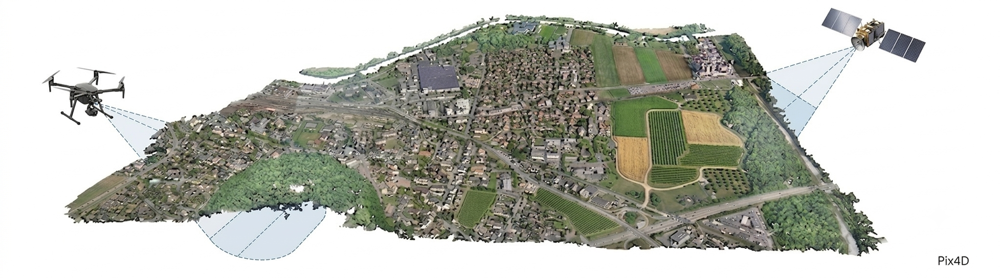
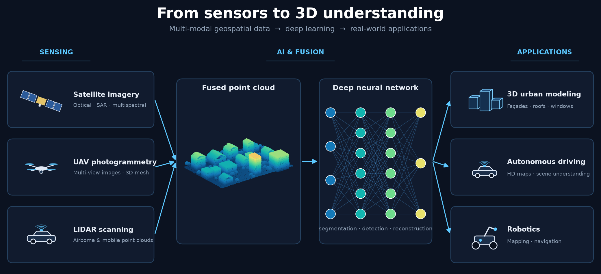

# Hi, I'm Abbas 👋
### Geospatial AI & Computer Vision Researcher

3D vision, LiDAR mapping, and deep learning for large-scale geospatial data.

---

## 🔬 About

I'm a researcher working at the intersection of **remote sensing**, **photogrammetry**, **computer vision**, and **machine learning**. My work focuses on turning LiDAR, point clouds, and imagery into accurate 3D models of urban environments, with applications in robotics and autonomous driving.

  

## 🎯 Research Interests

- **Remote Sensing** and **Geospatial Analysis**
- **3D Computer Vision** and **Photogrammetry**
- **3D Urban Modeling** and **AI-driven Image Processing**
- **Point Cloud** and **LiDAR Mapping**
- **Robotics** and **Autonomous Driving**

## 🛠️ Tech Stack

**Domain expertise:** LiDAR · Point Cloud Processing · Photogrammetry · Remote Sensing · GIS

## 📚 Selected Publications

| Year | Paper | Venue |
|---|---|---|
| 2026 | **[OccluFree: Occlusion-Aware Restoration for Amodal Building Windows and Doors Segmentation](https://doi.org/10.1109/JSTARS.2026.3724744)**   A. Salehitangrizi, S. Jabari, Y. Zhang | IEEE JSTARS |
| 2025 | **[Enhancing Cross-Modal Camera Image and LiDAR Data Registration Using Feature-Based Matching](https://www.mdpi.com/2072-4292/17/3/357)**   J. Leahy, S. Jabari, D. Lichti, A. Salehitangrizi | Remote Sensing |
| 2024 | **[3D Modeling of Façade Elements Using Multi-View Images from Mobile Scanning Systems](https://doi.org/10.1080/07038992.2024.2309895)**   A. Salehitangrizi, S. Jabari, M. Sheng, Y. Zhang | Canadian Journal of Remote Sensing |
| 2022 | **[Marine Habitat Mapping Using Bathymetric LiDAR Data: A Case Study from Bonne Bay, Newfoundland](https://www.mdpi.com/2073-4441/14/23/3809)**   M. Amani, C. Macdonald, A. Salehi, S. Mahdavi, M. Gullage | Water |
| 2017 | **[Building Roof Reconstruction Based on Residue Anomaly Analysis and Shape Descriptors from LiDAR and Optical Data](https://doi.org/10.14358/PERS.83.4.281)**   A. Salehi, A. Mohammadzadeh | Photogrammetric Engineering & Remote Sensing |

See the [full list on Google Scholar](https://scholar.google.com/citations?user=xg85-BEAAAAJ&hl=en).

## 🌱 Currently Exploring

- Advanced 3D computer vision
- Deep learning for large geospatial datasets
- Multi-modal data fusion
- Robotics and autonomous driving

<!--
## 🤝 Open to Collaborate

- 3D modeling and image processing
- Geospatial data processing, photogrammetry, and remote sensing
- Open-source work in AI and autonomous driving
-->